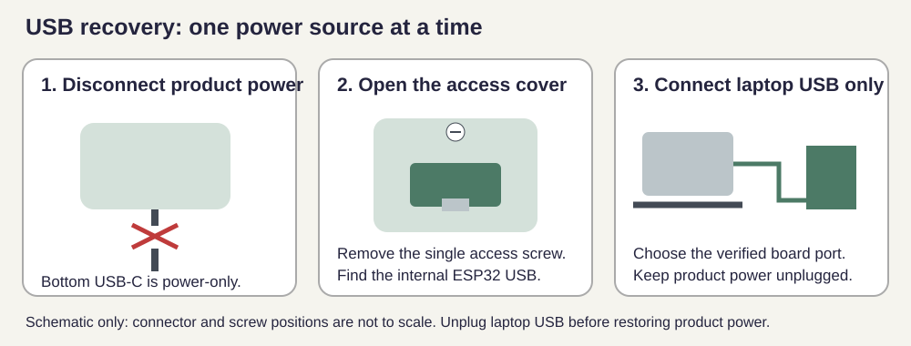

# USB recovery and first migration



**Never connect laptop USB and external/main power simultaneously.**
The bottom product USB-C connector is power-only. Use the internal ESP32 connector
for recovery; removing one screw provides access. The drawing is schematic, not
an enclosure fit/position claim.

1. Disconnect the bottom product power cable and any external/main supply.
2. Remove the access screw/cover and connect the laptop to the internal ESP32 USB.
3. Open `dragon-firmware/Recover Dragon.cmd`. Check **Prepared firmware: v0.3.0-beta.2**
   and the S3/C3 verification message. Refresh ports and select the current
   board's port. Confirm the USB-only checkbox after checking the actual wiring.
4. Choose **Update / recover firmware**. The tool reads the ROM chip identity and selects
   only its checksum-verified image. It rejects old single-slot bundles. Build and
   prepare the matching new release bundle before using it. For the published beta,
   extract `dragon-usb-recovery-bundle.zip` from the release into
   `dragon-firmware/.tools/recovery-release/` (so `current-set.json` is directly
   inside that folder). Download the source at the same release tag for the tool.
5. Keep USB connected. Saved NVS is privately backed up before writes and read back
   afterwards. A mismatch is a failure: retain the backup and stop. No whole-flash
   erase is used. Keep USB connected for startup validation (about one minute).
   Success requires the prepared version, ready storage, increasing uptime, the
   400 mA USB ceiling and VALID firmware. If asked, release BOOT and press RESET;
   **Check startup only** retries verification without writing again.
6. Verify saved dragons and settings. The webpage's parent password is always
   `dragon123`; no USB code, password change or credential recovery is needed.
7. Unplug laptop USB **before** reconnecting product power; then replace the cover
   and screw.
8. For another board, disconnect the finished board, connect the next with
   external/main power still disconnected, click **Refresh ports**, select its
   current port and confirm USB-only power again. S3/C3 selection is automatic.

If no port appears, use the controller's BOOT/RESET procedure from the existing
[flashing guide](BATCH-FLASHING.md). Do not assume a port from a previous session.
The launcher automatically uses the standalone esptool installed with the
Espressif Arduino package when available. This PC is prepared with that tool;
Arduino CLI is not needed for recovery.

If Windows Application Control blocks the selected tool, have the trusted tool
approved through the Windows policy; do not turn off protections globally.

The S3 has completed a physical NVS-preserving migration; C3 migration and
interruption tests remain pending. See [the candidate notes](NEXT-RELEASE.md) for the release gates.


A trusted standalone esptool can also be selected without Arduino CLI:

```powershell
python dragon-firmware/tools/recovery.py --port CURRENT_PORT --usb-only --esptool FULL_PATH_TO_ESPTOOL
```

This still verifies ROM identity, the live NVS layout and target bundle. Recovery
now resets the verified controller after unchanged-NVS readback and before checking
startup. Never reuse an earlier COM port without confirming the present board.
